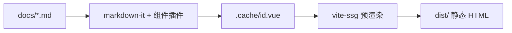

# 实现原理

本站就是 hello 自身的产物（dogfood）：`docs/` 里这两篇文档，正是由这套引擎在编译期渲染成静态 HTML 的。



## 三根路径模型

整个生成器建立在三根路径之上：

```define
PKG_ROOT | 包安装位置，承载引擎资源（src/ 下的 index.html / theme / 组件插件）
USER_ROOT | 用户项目根，即 CLI 的 cwd，或 hd dev <dir> 指定
WORK_DIR | USER_ROOT/.hd，编译中间产物与配置快照集中于此
```

```info 为什么 Vite root 指向 WORK_DIR
主题与路由里 `import.meta.glob('/.cache/...')` 的前导 `/` 是相对 Vite root 解析的。把 root 定成 WORK_DIR 后，`.cache` 恰好落在它下面，这些 glob 字面量一个字都不用改——主题侧改动趋近于零。
```

## 配置流

```flow
hd.config.ts | 用户只写与默认值的差异
jiti 运行时加载 | 绕开 TS 编译步骤，直接读 .ts 配置
合并默认值并校验 | title 必填，越界与非法取值在此拦截
ResolvedConfig | 编译管线与 CLI 共用的完整配置
.cache/site.json | 序列化为大写键，供主题读取
```

## 编译管线

```steps
准备缓存目录 | 确保 WORK_DIR/.cache 与 public 就位
比对编译签名 | 输入未变则短路复用上次产物
编译 Markdown | markdown-it 挂载组件插件，shiki 编译期高亮
产出文章组件 | 每篇 docs/id.md 生成 .cache/id.vue
派生侧栏与上下篇 | 由 docs/ 目录树推导，无需手写
写元数据 | post.json / search.json / sidebar.json / site.json
签名转正 | 构建成功后正式签名才描述磁盘上的产物
```

```info 两段式签名
构建开始先写 `.compile-sig.pending`，成功后再由 `finalizeSignature` 转正为 `.compile-sig`。若构建中途失败，正式签名仍描述磁盘上那份旧产物，避免输入回退时误判缓存而拿到半成品。
```

参与签名的输入：

```attrs
脚本 | 编译脚本自身的 mtime/size
插件 | plugins/ 下所有 .ts 的 mtime/size
内容 | docs/ 全量文件的 mtime/size
首页 | 顶层 index.md 的 mtime/size
配置 | 用户配置文件的 mtime/size
```

```tip 引擎改了旧文章也会失效
插件文件被计入签名，所以改完组件插件后，旧文章会自动重新编译，不会出现「改了插件但文章没重渲」的假象。
```

## 插件注册表

```filetree
src/build/plugins/
  base.ts | 契约与公共工具：splitRow / toolbar / makeInlineRule
  registry.ts | 登记表：汇总 fenceLangs，按语言名分发到各插件
  admonition.ts | 提示块 tip/info/warn/error
  mermaid.ts / echarts.ts | 图表容器（编译期拦截，运行时渲染）
  code-group.ts / tabs.ts | 代码组与选项卡
  filetree.ts / terminal.ts / details.ts / flow.ts | 结构类
  timeline.ts / steps.ts | 编排类
  cards.ts / links.ts / gallery.ts / stat.ts / progress.ts / attrs.ts | 展示类
  define.ts / qa.ts / compare.ts / quote.ts | 笔记类
  kbd.ts / badge.ts / mark.ts | 行内语法
```

新增一个写作组件 = 在 `plugins/` 加一个文件并实现 `ComponentPlugin`，再在 `registry.ts` 登记一行，核心编译脚本不用动。插件只产出语义化 HTML 与稳定的 class 约定，配色排版归 `content.css`——所以调样式不涉及这些组件的 JS。

## SSG 装配

```steps
收集路由 | 扫 .cache/*.vue 得到 /post/id，并显式补上 /404
逐路由预渲染 | vite-ssg 对每个路由产出一份静态 HTML
首屏即正文 | 产物 HTML 自带正文，兼顾 SEO 与无 JS 兜底
运行时接管 | 主题按文章懒加载 chunk，站内切换不刷新整页
```

## 运行时主题

```define
路由 | /post/:pathMatch(.*)* 承载含斜杠的文章 id（如 guide/install）
按需加载 | import.meta.glob 不加 eager，每篇文章是独立 chunk
单例状态 | composables 直接导出模块级 ref，全站唯一一份
链接预取 | 视口内站内链接在空闲时预取目标 chunk，消除切换闪烁
正文重初始化 | MutationObserver 监听正文子树，切文章后重挂图表与灯箱
```

## 延伸阅读

```links
Vue 3 | 组合式 API 与单文件组件 | https://vuejs.org
Vite | 构建工具与开发服务器 | https://vite.dev
shiki | 编译期语法高亮引擎 | https://shiki.style
```
